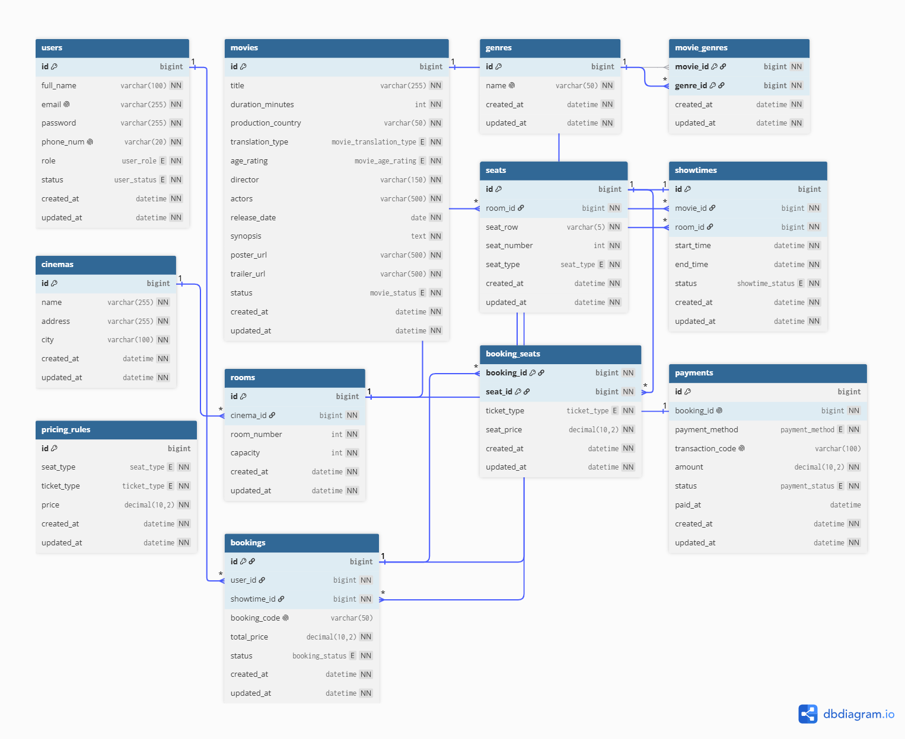

# Database Design

## Entity-Relationship Diagram (ERD)
**Click chuột phải vào ảnh và chọn open image in new tab để xem ảnh rõ hơn**
[](images/erd.png)

---

## Table

### users
Stores user account information.

| Field     | Type         | Constraints        | Description       |
|-----------|--------------|--------------------|-------------------|
| id        | BIGINT       | PK, AUTO_INCREMENT | User identifier   |
| full_name | VARCHAR(100) | NOT NULL           | Full name         |
| email     | VARCHAR(255) | UNIQUE, NOT NULL   | User email        |
| password  | VARCHAR(255) | NOT NULL           | Hashed password   |
| phone_num | VARCHAR(20)  | UNIQUE, NOT NULL   | Phone number      |
| role      | ENUM         | NOT NULL       | ADMIN / USER      |
| status    | ENUM         | NOT NULL           | ACTIVE / INACTIVE |
| created_at | TIMESTAMP    | NOT NULL           | Created time      |
| updated_at | TIMESTAMP    | NOT NULL           | Updated time      |

---

### genres

Represents a movie genre category.

| Attribute | Type | Constraints | Description      |
|---|---|---|------------------|
| id | BIGINT | PK, AUTO_INCREMENT | Genre identifier |
| name | VARCHAR(50) | NOT NULL, UNIQUE | Genre name       |
| created_at | TIMESTAMP    | NOT NULL           | Created time      |
| updated_at | TIMESTAMP    | NOT NULL           | Updated time      |

---

### movies
Stores movie information.

| Field              | Type         | Constraints        | Description                        |
|--------------------|--------------|--------------------|------------------------------------|
| id                 | BIGINT       | PK, AUTO_INCREMENT | Movie identifier                   |
| title              | VARCHAR(255) | NOT NULL           | Movie title                        |
| duration_minutes   | INT          | NOT NULL           | Duration in minutes                |
| production_country | VARCHAR(50)  | NOT NULL           | Movie production country           |
| translation_type   | ENUM         | NOT NULL           | SUBTITLE / DUBBED                  |
| age_rating         | ENUM         | NOT NULL           | P / K / T13 / T16 / T18            |
| director           | VARCHAR(150) | NOT NULL           | Movie director                     |
| actors             | VARCHAR(500) | NOT NULL           | Movie actors                       |
| release_date       | DATE        | NOT NULL           | Release date                       |
| synopsis           | TEXT         | NOT NULL           | Movie synopsis                     |
| poster_url         | VARCHAR(500) | NOT NULL           | Poster URL                         |
| trailer_url        | VARCHAR(500) | NOT NULL           | Trailer URL                        |
| status             | ENUM        | NOT NULL           | COMMING_SOON / NOW_SHOWING / ENDED |
| created_at         | TIMESTAMP   | NOT NULL           | Created time                       |
| updated_at         | TIMESTAMP   | NOT NULL           | Updated time                       |

---

### movie_genres

Junction table representing the many-to-many relationship between movies and genres.

| Attribute | Type | Constraints | Description |
|---|---|---|---|
| movie_id | BIGINT | PK, FK | Referenced movie |
| genre_id | BIGINT | PK, FK | Referenced genre |
| created_at | TIMESTAMP    | NOT NULL           | Created time      |
| updated_at | TIMESTAMP    | NOT NULL           | Updated time      |

### cinemas
Stores cinema branch information.

| Field | Type | Constraints | Description |
|---|---|---|---|
| id | BIGINT | PK, AUTO_INCREMENT | Cinema identifier |
| name | VARCHAR(255) | NOT NULL | Cinema name |
| address | VARCHAR(255) | NOT NULL | Cinema address |
| city | VARCHAR(100) | NOT NULL | City |
| created_at | TIMESTAMP | NOT NULL | Created time |
| updated_at         | TIMESTAMP   | NOT NULL | Updated time                       |

---

### rooms
Stores screening rooms.

| Field       | Type      | Constraints | Description       |
|-------------|-----------|---|-------------------|
| id          | BIGINT    | PK, AUTO_INCREMENT | Room identifier   |
| cinema_id   | BIGINT    | FK, NOT NULL | Cinema identifier |
| room_number | int       | NOT NULL | Room number       |
| capacity    | INT       | NOT NULL | Total seats       |
| created_at  | TIMESTAMP | NOT NULL | Created time      |
| updated_at  | TIMESTAMP | NOT NULL | Updated time      |

---

### seats
Stores room seat information.

| Field | Type | Constraints | Description     |
|---|---|---|-----------------|
| id | BIGINT | PK, AUTO_INCREMENT | Seat identifier |
| room_id | BIGINT | FK, NOT NULL | Room identifier |
| seat_row | VARCHAR(5) | NOT NULL | Seat row        |
| seat_number | INT | NOT NULL | Seat number     |
| seat_type | ENUM | NOT NULL | SINGLE / COUPLE |
| created_at | TIMESTAMP | NOT NULL | Created time    |
| updated_at         | TIMESTAMP   | NOT NULL | Updated time                       |

---

### showtimes
Stores movie schedules.

| Field | Type | Constraints | Description                       |
|---|---|---|-----------------------------------|
| id | BIGINT | PK, AUTO_INCREMENT | Showtime identifier               |
| movie_id | BIGINT | FK, NOT NULL | Movie identifier                  |
| room_id | BIGINT | FK, NOT NULL | Room identifier                   |
| start_time | TIMESTAMP | NOT NULL | Start time                        |
| end_time | TIMESTAMP | NOT NULL | End time                          |
| status | ENUM | NOT NULL | AVAILABLED / COMPLETED / CANCELED |
| created_at | TIMESTAMP | NOT NULL | Created time                      |
| updated_at         | TIMESTAMP   | NOT NULL | Updated time                      |

---

### pricing_rules
Represents pricing configuration based on seat type and day type.

| Field       | Type | Constraints | Description                          |
|-------------|---|---|--------------------------------------|
| id          | BIGINT | PK | Pricing rule identifier              |
| seat_type   | ENUM | NOT NULL | SINGLE / COUPLE                      |
| ticket_type | ENUM | NOT NULL | ADULT / SENIOR / STUDENT_U22 / CHILD |
| price       | DECIMAL(10,2) | NOT NULL | Ticket price                         |
| created_at  | TIMESTAMP | NOT NULL | Created time                         |
| updated_at  | TIMESTAMP   | NOT NULL | Updated time                         |

---

### bookings
Stores booking transactions.

| Field        | Type | Constraints        | Description                |
|--------------|---|--------------------|----------------------------|
| id           | BIGINT | PK, AUTO_INCREMENT | Booking identifier         |
| user_id      | BIGINT | FK, NOT NULL       | User identifier            |
| showtime_id  | BIGINT | FK, NOT NULL       | Showtime identifier        |
| booking_code | VARCHAR(50) | UNIQUE             | Booking code               |
| total_price  | DECIMAL(10,2) | NOT NULL           | Total amount               |
| status       | ENUM | NOT NULL           | PENDING / PAID / CANCELLED |
| created_at   | TIMESTAMP | NOT NULL           | Created time/Booked time   |
| updated_at   | TIMESTAMP   | NOT NULL           | Updated time               |

---

### booking_seats
Stores selected seats in a booking.

| Field       | Type | Constraints | Description |
|-------------|---|---|---|
| booking_id  | BIGINT | PK, FK | Booking identifier |
| seat_id     | BIGINT | PK, FK | Seat identifier |
| ticket_type | ENUM | NOT NULL | ADULT / SENIOR / STUDENT_U22 / CHILD |
| seat_price  | DECIMAL(10,2) | NOT NULL | Seat price |
| created_at  | TIMESTAMP | NOT NULL | Created time |
| updated_at  | TIMESTAMP   | NOT NULL | Updated time                       |

---

### payments
Stores payment transactions.

| Field            | Type          | Constraints        | Description                |
|------------------|---------------|--------------------|----------------------------|
| id               | BIGINT        | PK, AUTO_INCREMENT | Payment identifier         |
| booking_id       | BIGINT        | FK, NOT NULL       | Booking identifier         |
| payment_method   | ENUM          | NOT NULL           | MOMO / VNPAY               |
| transaction_code | VARCHAR(100)  | UNIQUE   | Transaction code           |
| amount           | DECIMAL(10,2) | NOT NULL           | Payment amount             |
| status           | ENUM          | NOT NULL           | PENDING / SUCCESS / FAILED |
| paid_at          | TIMESTAMP     | NOT NULL           | Payment time               |
| created_at       | TIMESTAMP     | NOT NULL           | Created time               |
| updated_at         | TIMESTAMP   | NOT NULL           | Updated time                       |

---

## Primary Keys
- users.id
- genres.id
- movies.id
- cinemas.id
- rooms.id
- seats.id
- showtimes.id
- bookings.id
- payments.id

## Composite Primary Key
- movie_genres (movie_id, genre_id)
- booking_seats (booking_id, seat_id)

---

## Foreign Keys

| Table         | Foreign Key | References   |
|---------------|-------------|--------------|
| rooms         | cinema_id   | cinemas.id   |
| users         | role_id     | roles.id     | 
| seats         | room_id     | rooms.id     |
| showtimes     | movie_id    | movies.id    |
| showtimes     | room_id     | rooms.id     |
| bookings      | user_id     | users.id     |
| bookings      | showtime_id | showtimes.id |
| booking_seats | booking_id  | bookings.id  |
| booking_seats | seat_id     | seats.id     |
| payments      | booking_id  | bookings.id  |

---

## Unique Constraints
- seats (room_id, seat_row, seat_number)
- pricing_rules (seat_type, day_type)

---

## Database relationships

* **cinemas -> rooms (1 - N):** 1 Rạp có nhiều Phòng chiếu.
* **rooms -> seats (1 - N):** 1 Phòng chiếu có nhiều Ghế cố định.
* **movies <-> genres (N - N via movie_genres):** 1 Phim thuộc nhiều Thể loại và ngược lại.
* **movies -> showtimes (1 - N):** 1 Phim có nhiều Suất chiếu.
* **rooms -> showtimes (1 - N):** 1 Phòng chiếu phục vụ nhiều Suất chiếu.
* **users -> bookings (1 - N):** 1 Người dùng tạo nhiều Đơn đặt vé.
* **showtimes -> bookings (1 - N):** 1 Suất chiếu tiếp nhận nhiều Đơn đặt vé.
* **bookings <-> seats (N - N via booking_seats):** 1 Đơn vé chọn nhiều Ghế; 1 Ghế được đặt ở nhiều Đơn vé khác nhau.
* **bookings <-> payments (1 - 1):** 1 Đơn vé đi kèm duy nhất 1 Giao dịch thanh toán.
* **pricing_rules (Standalone Table):** Bảng tra cứu giá vé dựa trên `seat_type` (từ `seats`) và `ticket_type` (từ `booking_seats`).
---

## Composite index

```sql
-- 1. Lọc Lịch chiếu theo Phim & Rạp (Tự động sắp xếp theo Khung giờ)
CREATE INDEX idx_showtimes_movie_room_time ON showtimes (movie_id, room_id, start_time);

-- 2. Xem Lịch sử đặt vé ở Trang cá nhân (Xếp theo thời gian mới nhất)
CREATE INDEX idx_bookings_user_created ON bookings (user_id, created_at);

-- 3. Render sơ đồ ghế (Lọc nhanh các ghế ĐÃ ĐẶT / ĐANG GIỮ CHỖ của suất chiếu)
CREATE INDEX idx_bookings_showtime_status ON bookings (showtime_id, status);